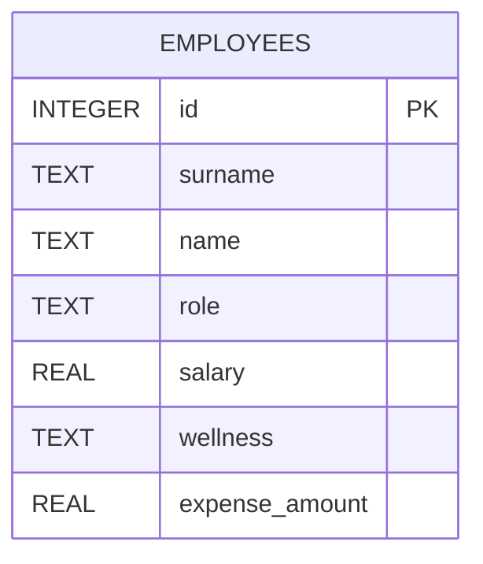

# Database

This document describes the database implementation.

The database framework used is **SQLite3** (Python's built-in `sqlite3` module).

No installation required — `sqlite3` is part of the Python standard library since Python 2.5.

## Database schema

A single table is used. Given the scope of this project (benchmarking LLM evaluation tools), no complex database architecture is required.



## Database initialization

The `init_db_sqlite3.py` script executes a single SQL command to create the `EMPLOYEES` table:

```sql
CREATE TABLE IF NOT EXISTS employees (
    id INTEGER PRIMARY KEY AUTOINCREMENT,
    surname TEXT NOT NULL,
    name TEXT NOT NULL,
    role TEXT NOT NULL DEFAULT 'employee' CHECK (role IN ('employee', 'HR')),
    salary REAL NOT NULL DEFAULT 1200,
    wellness TEXT NOT NULL CHECK (wellness IN ('healthy', 'unhealthy', 'wait for a wellness checkup')),
    expense_amount REAL NOT NULL DEFAULT 0
)
```

### Columns

**`id`**
Unique integer identifier, automatically assigned when an employee is created. Primary key of the table.

**`surname`**
The employee's surname. Cannot be `NULL`.

**`name`**
The employee's first name. Cannot be `NULL`.

**`role`**
The employee's role within the company. Two roles are allowed: `employee` and `HR`.

`HR` grants exclusive access to `salary`, `wellness`, and `expense_amount` for all employees. See [ACCESS_CONTROL.md](../ACCESS_CONTROL.md) for details on permissions.

Cannot be `NULL`; defaults to `employee`.

**`salary`**
The employee's salary. Cannot be `NULL`; defaults to `1200`.

**`wellness`**
The employee's self-reported work wellness. Cannot be `NULL`. Must be one of: `healthy`, `unhealthy`, `wait for a wellness checkup`.

**`expense_amount`**
The cumulative amount of expenses submitted by the employee. Cannot be `NULL`; defaults to `0`.


