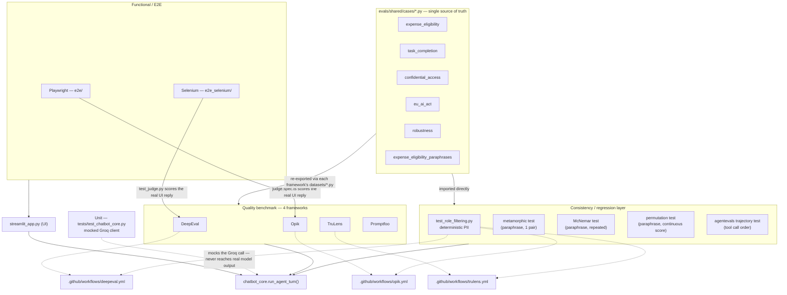

This document gives a single map of every test suite built for this project, and how they relate to each other. Every suite listed here has its own dedicated documentation — this page exists because none of those pages, read individually, show how the pieces connect.

Testing an LLM agent can't be done with one technique alone. A single assertion like `assert reply == "Bruxelles"` doesn't survive contact with a model that can phrase a correct answer a dozen different ways (see the non-determinism problem in `presentation_pw.md`). So this project layers several different testing strategies, each answering a different question about the same underlying agent, `chatbot_core.run_agent_turn()`:

- **Unit** : is the orchestration code (history management, tool dispatch, error handling) correct, independently of what the model says?
- **Functional / E2E** : does the real, deployed app work for a real user clicking through a real browser?
- **Quality (LLM-as-judge)** : does the model's actual output — tool choice, refusal, faithfulness, task completion — meet a bar of "good enough", judged by another LLM? This is the four-framework benchmark (DeepEval, TruLens, Opik, Promptfoo) that is the core deliverable of this project (see [`goals.md`](../goals.md)).
- **Consistency / regression** : does the agent's behavior stay stable — across rewordings of the same request, across repeated sampling of the same input, across the expected order of its own tool calls — rather than just passing once?

## Diagram



## Is there continuity between the tests?

Yes — deliberately, at three different levels.

**1. One case bank, five frameworks/suites.** [`evals/shared/cases/`](../evals/shared/cases/) holds the actual test scenarios (`expense_eligibility.py`, `task_completion.py`, `confidential_access.py`, `eu_ai_act.py`, `robustness.py`, `expense_eligibility_paraphrases.py`). Every framework's own `datasets/*.py` file is a one-line re-export of it, e.g. `evals/deepeval/datasets/expense_eligibility_cases.py`:

```python
from evals.shared.cases.expense_eligibility import EXPENSE_ELIGIBILITY_CASES  # noqa: F401
```

The exact same line appears in `evals/trulens/datasets/`, `evals/opik/datasets/`, and `evals/promptfoo/datasets/`. This means DeepEval, TruLens, Opik and Promptfoo are all judging **the same scenarios**, not four independently-invented sets of examples — a real requirement for the benchmark to be a fair comparison of the frameworks themselves, rather than a comparison of four different question sets. The consistency/regression suites (metamorphic, McNemar, permutation, agentevals) import from `evals/shared/cases/` directly, for the same reason.

**2. One production entry point.** Every suite except the unit suite and the two E2E suites calls `chatbot_core.run_agent_turn()` directly — the exact function `streamlit_app.py` calls in production. No suite wraps it, re-implements it, or tests a simplified stand-in. A regression in the real orchestration code is visible to all of them at once.

**3. One database fixture.** [`evals/conftest.py`](../evals/conftest.py) re-exports `evals/shared/conftest.py`'s `reset_test_employee_expense` autouse fixture, so every test under `evals/` — regardless of which framework or suite directory it lives in — starts from the same clean `expense_amount = 0` database state, independent of execution order or what a previous manual Streamlit session left behind.

**4. Shared instrumentation, not shared identity.** The regression layer doesn't reinvent scoring: the McNemar and permutation tests reuse DeepEval's `GroqJudge`/`GEval` machinery (`eligibility_decision_correctness`) purely as a scoring instrument, and the CI-blocking PII check (`test_role_filtering.py`) is literally the same file run by all three CI workflows (`deepeval.yml`, `opik.yml`, `trulens.yml`) instead of being copy-pasted three times.

**What's deliberately *not* connected.** `tests/test_chatbot_core.py` (unit) mocks the Groq client entirely — it needs exact, hand-crafted mocked responses to test specific orchestration branches (tool call, no tool call, unknown tool), so it has no use for the shared case bank, which exists to describe realistic user scenarios, not orchestration edge cases. Likewise `e2e/` and `e2e_selenium/` drive the UI with a couple of hardcoded logins and chat messages rather than the case bank — their job is to verify the app *renders and responds*, not to re-run the full scenario suite through a browser, which would multiply every case's cost by a real Chromium session for no added signal.

## Suite-by-suite reference

| Layer | Suite | Docs |
|---|---|---|
| Unit | `tests/test_chatbot_core.py` | [`MOCKING_TEST.md`](./MOCKING_TEST.md) |
| Functional / E2E | `e2e/` (Playwright) | [`PLAYWRIGHT_TEST.md`](./PLAYWRIGHT_TEST.md) |
| Functional / E2E | `e2e_selenium/` (Selenium) | [`SELENIUM_TEST.md`](./SELENIUM_TEST.md) |
| Functional / E2E + Quality | `e2e/judge.spec.ts` (Playwright + Opik judge, real UI output) | [`PLAYWRIGHT_TEST.md`](./PLAYWRIGHT_TEST.md) |
| Functional / E2E + Quality | `e2e_selenium/test_judge.py` (Selenium + DeepEval judge, real UI output) | [`SELENIUM_TEST.md`](./SELENIUM_TEST.md) |
| Quality | DeepEval | [`DEEPEVAL_TEST.md`](./DEEPEVAL_TEST.md), [`DEEPEVAL_LLM_AS_A_JUDGE.md`](./DEEPEVAL_LLM_AS_A_JUDGE.md) |
| Quality | TruLens | [`TRULENS_TEST.md`](./TRULENS_TEST.md), [`TRULENS_LLM_AS_A_JUDGE.md`](./TRULENS_LLM_AS_A_JUDGE.md) |
| Quality | Opik | [`OPIK_TEST.md`](./OPIK_TEST.md), [`OPIK_LLM_AS_A_JUDGE.md`](./OPIK_LLM_AS_A_JUDGE.md) |
| Quality | Promptfoo | *(pending documentation)* |
| Regression | `evals/shared/test_role_filtering.py` | referenced in [`DEEPEVAL_CI_WORKFLOW.md`](./DEEPEVAL_CI_WORKFLOW.md) |
| Regression | Metamorphic test | [`METAMORPHIC_TEST.md`](./METAMORPHIC_TEST.md) |
| Regression | McNemar statistical test | [`STATISTICAL_TEST.md`](./STATISTICAL_TEST.md) |
| Regression | pass@k reliability test | [`STATISTICAL_TEST.md`](./STATISTICAL_TEST.md) — validated (2/3 real), 1 finding open |
| Regression | Permutation statistical test | *(pending real-run validation)* |
| Regression | AgentEvals trajectory test | validated (2/3 real, 1 finding under review) — *(pending documentation)* |
| Meta / judge calibration | `evals/shared/test_judge_calibration.py` | [`JUDGE_CALIBRATION.md`](./JUDGE_CALIBRATION.md) — skeleton only, unlabeled |
| Regression | Opik Dataset/evaluate() drift monitoring (`evals/shared/regression_experiment.py`) | [`REGRESSION_MONITORING.md`](./REGRESSION_MONITORING.md) — manual only, no scheduler yet |
| CI | `.github/workflows/*.yml` | [`DEEPEVAL_CI_WORKFLOW.md`](./DEEPEVAL_CI_WORKFLOW.md) |
